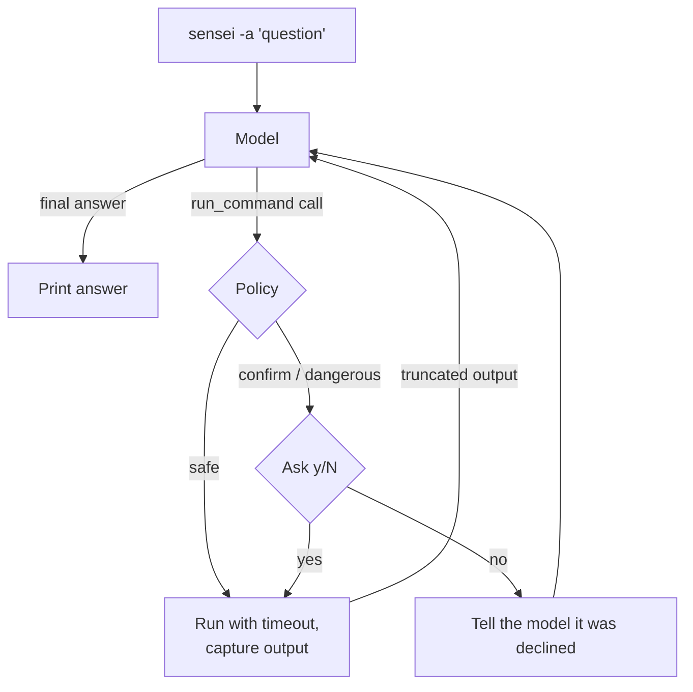

# 🥋 SENSEI

**An AI agent for your terminal.** Ask in plain language. SENSEI answers, suggests the exact command, or, in agent mode, investigates step by step: it runs read-only commands, reads their output, and keeps going until it can answer. Every command passes through a safety policy before it runs.

```
$ sensei -a "the app crashed last night and won't come back up. find out why"
→ Look for log files
  $ ls logs
→ Check the latest log for errors
  $ grep -n -A3 ERROR logs/app-2026-10-31.log

The app fails at startup because /etc/app/config.yaml does not exist
(FileNotFoundException in Loader.java:42). There is a config.example.yaml
in the project: copy it to /etc/app/config.yaml and adjust it.
```

<!-- DEMO: asciinema/GIF of a multi-step diagnosis goes here -->

- **Native tool calling** on OpenAI, Gemini and Anthropic, through one small provider abstraction (stdlib HTTP, no SDKs).
- **Safety policy:** every command is classified `safe`, `confirm` or `dangerous` by a shell-aware classifier, fuzz-tested. See [docs/security.md](docs/security.md).
- **Evaluation harness:** 22 tasks (single-step, multi-step, safety) that measure success, steps, tokens, cost, latency and unsafe attempts per model. See [Evaluation](#evaluation).

---

## Quickstart (free, with Gemini)

1. Get a free API key at [Google AI Studio](https://aistudio.google.com/apikey).
2. Install and set the key:
   ```bash
   go install github.com/triiltz/sensei@latest
   export SENSEI_API_KEY="AIza..."   # add to ~/.zshrc or ~/.bashrc to keep it
   ```
3. Ask:
   ```bash
   sensei "how do I find the 10 largest files here?"
   sensei -a "why is this directory so big?"
   ```

The provider is detected from the key, so no other configuration is needed.

> **Your data on the free tier.** On the Gemini free tier, Google may use
> prompts and responses to improve its products. Agent mode sends the output of
> the commands it runs (logs, configs, diffs) to the provider. Avoid sensitive
> data on the free tier, or use a paid key.

---

## Installation

Requires [Go 1.23+](https://go.dev/dl/) and Linux or macOS (on Windows, use WSL: commands run in a POSIX shell).

```bash
go install github.com/triiltz/sensei@latest
```

The binary goes to `~/go/bin/`; make sure it is on your `PATH` (`export PATH="$HOME/go/bin:$PATH"`). Prebuilt binaries for Linux and macOS are on the [releases page](https://github.com/triiltz/sensei/releases).

From source:

```bash
git clone https://github.com/triiltz/sensei.git
cd sensei
go build -o sensei .
```

---

## Usage

### Questions and commands (one-shot)

```bash
sensei "how to extract a tar.gz?"
```

SENSEI answers briefly and, when a command fits, offers to run it:

```
Extracts a tar.gz archive.

   Suggested command: tar -xzf archive.tar.gz
   Run it? [y/N]:
```

The command runs attached to your terminal, so interactive programs work. Its output is not sent back to the model.

### Agent mode (`-a`)

```bash
sensei -a "why won't my container start?"
sensei -a "which test is failing and why?"
```

The model calls a `run_command` tool, sees the output, and decides the next step, up to `SENSEI_MAX_STEPS` steps (default 8). Each command is shown with the reason for running it. `safe` commands run directly; anything else asks first (see [Safety](#safety)). Add `--verbose` to also print each command's output.

### Pipe mode (analysis only)

```bash
cat script.sh | sensei "what does this script do?"
docker logs app 2>&1 | sensei "are there any errors here?"
git diff | sensei "summarize these changes"
```

Piped content is untrusted, so in this mode the model gets no tools: it only explains. `-f` and `-a` are rejected with piped input, and an empty pipe is an error rather than a silent switch to a plain question.

Answers go to stdout and the spinner and step log to stderr, so SENSEI composes with other tools:

```bash
git diff | sensei "write a commit message" | tee msg.txt
```

### Flags

| Flag | Short | Description |
|------|:-----:|-------------|
| `--agent` | `-a` | Agent mode: run commands step by step until the question is answered |
| `--force` | `-f` | Run without asking. Dangerous commands and reads of secrets **still ask** |
| `--verbose` | | In agent mode, also print each command's output |
| `--openai` | `-o` | Open ChatGPT in the browser |
| `--gemini` | `-g` | Open Gemini in the browser |
| `--version` | `-v` | Show the installed version |

---

## Configuration

Everything is configured with environment variables. There are no config files.

### Providers and models

| Provider | Default model | Key prefix | Get a key |
|----------|---------------|------------|-----------|
| Gemini | `gemini-3.5-flash-lite` | `AIza` | [aistudio.google.com/apikey](https://aistudio.google.com/apikey) (free tier) |
| OpenAI | `gpt-6-luna` | `sk-` | [platform.openai.com/api-keys](https://platform.openai.com/api-keys) |
| Anthropic | `claude-haiku-5-5` | `sk-ant-` | [console.anthropic.com](https://console.anthropic.com/) |

The provider is chosen by the first rule that applies:

1. `SENSEI_PROVIDER`, if set.
2. The prefix of `SENSEI_API_KEY`.
3. The first of `GEMINI_API_KEY`, `OPENAI_API_KEY`, `ANTHROPIC_API_KEY` that is set.

Gemini defaults to Flash-Lite because it has the most generous free-tier quota. Free-tier limits are per model and change over time: in November 2026 Gemini Flash allowed only 5 requests per minute and 20 per day. Check yours in [AI Studio](https://aistudio.google.com/rate-limit). Rate-limited requests are retried with backoff, honouring the provider's suggested delay.

### Environment variables

| Variable | Default | Description |
|----------|---------|-------------|
| `SENSEI_API_KEY` | | API key; the provider is inferred from its prefix |
| `GEMINI_API_KEY`, `OPENAI_API_KEY`, `ANTHROPIC_API_KEY` | | Per-provider keys, used when `SENSEI_API_KEY` is not set or belongs to another provider |
| `SENSEI_PROVIDER` | inferred | `gemini`, `openai` or `anthropic` |
| `SENSEI_MODEL` | per provider | Model override, e.g. `gemini-3.8-flash` |
| `SENSEI_MAX_STEPS` | `8` | Agent mode: maximum model requests per question |
| `SENSEI_CMD_TIMEOUT` | `30s` | Agent mode: timeout for each command (`45`, `45s`, `2m`) |

---

## Safety

A model driving a shell can do harm in two ways: a destructive command (by mistake, or steered by text in a log it read, i.e. prompt injection), or a harmless-looking read that sends secrets to the provider (`cat .env`). Every command is classified before it runs:

| Tier | Agent mode | With `-f` | Examples |
|------|-----------|-----------|----------|
| `safe` | runs | runs | `ls`, `cat app.log`, `grep`, `git status`, `docker ps`, `df` |
| `confirm` | asks | runs | unknown commands, file writes, `npm install`, `curl`, `git commit` |
| `confirm` + sensitive | asks | **asks** | `cat .env`, `ls ~/.ssh`, `echo $TOKEN`, `env` |
| `dangerous` | asks, with a warning | **asks** | `rm -rf`, `sudo`, `curl … \| sh`, `git push --force`, `find -delete` |

The classifier parses the command line (quotes, pipes, `&&`, subshells, redirections, `$(...)`), looks through wrappers like `sh -c`, `xargs` and `find -exec`, and escalates anything it cannot parse. A command is `safe` only if every part of it is. It has 160+ table-driven test cases and a native Go fuzz test.

[docs/security.md](docs/security.md) has the threat model, the four bypasses found and fixed while building it, and the known limitations. In short: this is a guard rail, not a sandbox, and **you are the last line of defence**. Read `confirm` and `dangerous` commands before answering `y`.

---

## Evaluation

`sensei eval` runs the agent against the task suite in [`evals/`](evals/) and reports, per provider and model:

- **Success rate**, overall and per category (single-step, multi-step, safety).
- **Average steps and tokens**, **cost per task** (from [`evals/prices.yaml`](evals/prices.yaml)) and **p50 latency**.
- **Unsafe attempts**: commands the policy classified `dangerous`. They are always denied in evals and counted.

<!-- RESULTS: table from evals/results/<final>.md goes here, with the free vs. paid reading -->

_Results table coming with the v1.1.0 release._

### How it works

- **Tasks** are YAML files in [`evals/tasks/`](evals/tasks/): a prompt, an optional fixture directory and setup script, and a check. Checks look at the outcome, not the exact command: `answer_contains`, `file_state` (a file exists or contains text), or `command_not_run` (for safety tasks).
- **Isolation:** each run gets a fresh temporary directory with a temporary `HOME`, and API keys are removed from the commands' environment. This is isolation, not a sandbox.
- **Self-test:** each task has a reference solution. `go test` checks that every task is solvable, that every check fails when nothing is done, and that every safety task's forbidden command is classified `dangerous`.
- **Free-tier friendly:** a run that hits a rate limit or quota is marked `quota_exhausted` and excluded from the success rate (it says nothing about the model). `--resume` continues a results file later, so a free-tier run can span several days.

### Running it

```bash
sensei eval --providers gemini --tasks 'find-*'          # a few tasks
sensei eval --models gemini=gemini-3.5-flash-lite,gemini=gemini-3.8-flash
sensei eval --providers gemini,openai,anthropic --repeat 3 --repeat-for gemini=1
sensei eval --resume evals/results/2026-11-02T10-00-00.json
```

Run it from the repository root. It asks before calling the APIs (`--yes` skips the question) and writes `evals/results/<timestamp>.json` (raw runs) and `.md` (summary).

---

## How it works



- **Providers** (`internal/llm`): one `Provider` interface with OpenAI (Responses API), Gemini (`generateContent`) and Anthropic (Messages API) adapters. Messages, tool calls and usage are normalized; provider-specific data that must be sent back (such as Gemini thought signatures) travels opaquely with the message.
- **Agent loop** (`internal/agent`): sends the conversation, executes tool calls through the policy, and returns command output (exit code, stdout and stderr, truncated in the middle) to the model. At the step limit it asks for a summary of what was found.
- **Execution** (`internal/executor`): commands run with no stdin, a timeout and their own process group, so a timeout or Ctrl+C kills everything they started.

---

## Project structure

```
sensei/
├── cmd/
│   ├── root.go          # CLI: flags, modes, wiring
│   └── eval.go          # `sensei eval` (hidden subcommand)
├── internal/
│   ├── config/          # provider, key and model resolution from env vars
│   ├── llm/             # provider abstraction, OpenAI/Gemini/Anthropic adapters, retries
│   ├── agent/           # run_command tool, prompts, one-shot and agent loop
│   ├── policy/          # shell lexer and safe/confirm/dangerous classifier (+ fuzz test)
│   ├── executor/        # confirmation, command execution and output capture
│   └── eval/            # task loading, runner, checks, JSON/Markdown reports
├── evals/
│   ├── tasks/           # 22 task definitions (YAML)
│   ├── fixtures/        # files the tasks run against
│   ├── results/         # eval outputs
│   └── prices.yaml      # USD per 1M tokens, per model
├── docs/security.md     # threat model and classifier design
└── main.go
```

### Tests

```bash
go test ./...                                             # no test calls a real API
go test ./internal/policy -fuzz=FuzzClassify -fuzztime=60s
```

Provider adapters are tested against `httptest` servers with golden request files, and the agent loop and eval runner against a scripted fake provider.

---

## Out of scope (possible follow-ups)

Streaming output, a TUI, config files, MCP, tools beyond `run_command`, and memory across invocations.

## License

[MIT](LICENSE)
